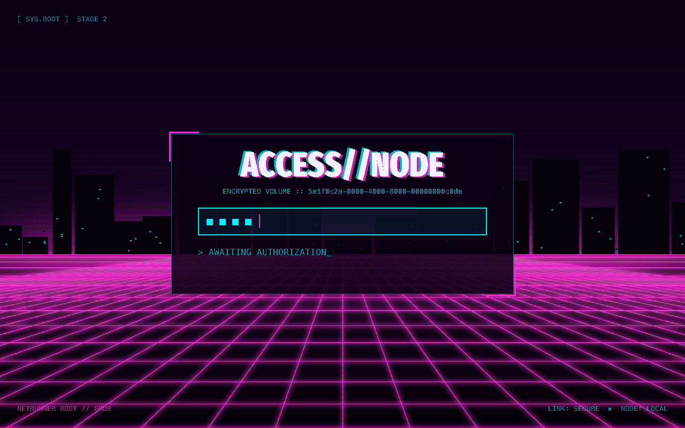
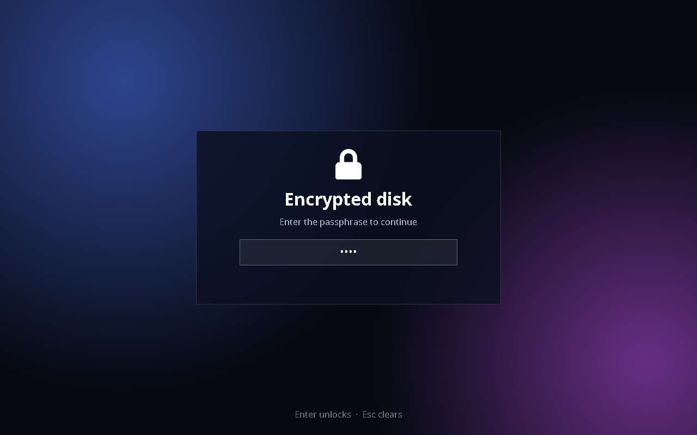
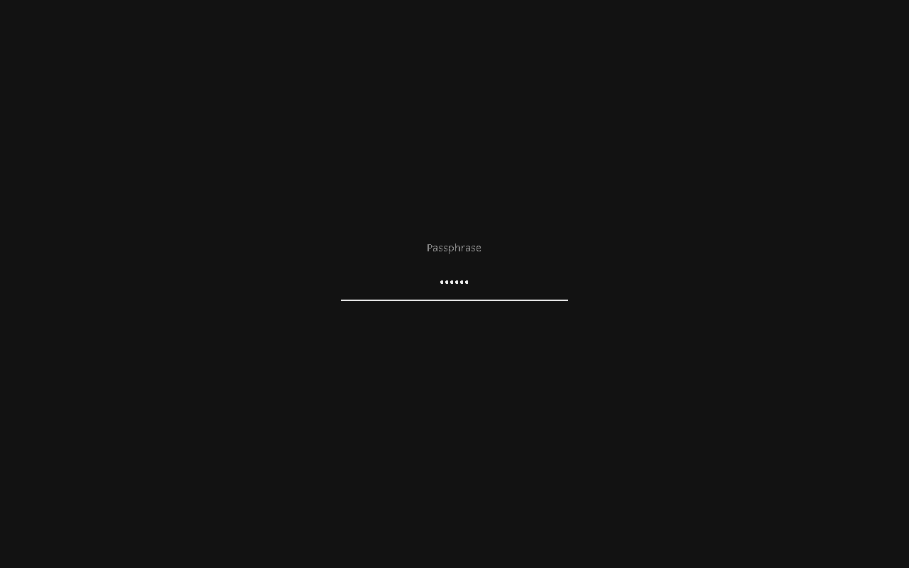
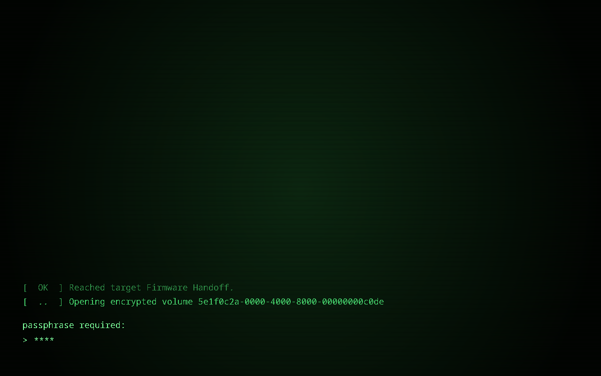

# GRUB_LUKS_splash

A themed passphrase screen for LUKS disks unlocked by GRUB.

When GRUB unlocks an encrypted disk, it asks for the passphrase with one line of plain console text, between a themed boot menu and a themed boot splash. GRUB_LUKS_splash replaces that line with a full-screen, themeable unlock screen. It is set up by an installer, and it falls back to the normal prompt if anything goes wrong.

| cyberpunk | midnight |
|---|---|
|  |  |
| **minimal** | **terminal** |
|  |  |

## Features

- Background images, panels, logos and text, with fonts, colors, and positions that can be centered or given in pixels or percentages. See the [theme format](docs/theme-format.md).
- Separate looks for typing, checking the passphrase, and after a wrong passphrase, which also shows the attempts left.
- Masked input: one mark per character, a fixed number of marks (hides the length), or nothing at all.
- Themes are checked before installing: syntax, files, fonts, characters, and image formats GRUB can read.
- Safe: a broken theme falls back to the stock prompt, original files are backed up, and uninstall restores them.

## Install

Requirements: x86_64 UEFI, GRUB 2.16 (the system's version and the version the module is built from must match), Python 3, and the usual GRUB build tools (gcc, autotools, bison, flex, freetype2 for `grub-mkfont`).

```
git clone https://github.com/NoX2SR/GRUB_LUKS_splash.git
cd GRUB_LUKS_splash
sudo ./install.py        # asks which GRUB and which theme
sudo ./uninstall.py      # restores the original setup
```

The first run builds GRUB with the module (`scripts/build-grub.sh`, about a minute). Under `sudo`, the build runs as your normal user.

Every question can also be given as an option. With all options plus `--yes`, the scripts never ask, so they can be used from other scripts:

```
sudo ./install.py --grub-location /boot/efi/EFI/cachyos-menu/grubx64.efi --theme cyberpunk --yes
sudo ./uninstall.py --grub-location /boot/efi/EFI/cachyos-menu/grubx64.efi --yes
```

| Option | |
|---|---|
| `--grub-location PATH` | The GRUB EFI image that asks for the passphrase |
| `--theme NAME\|DIR\|ARCHIVE` | A bundled theme, your own theme directory, or a downloaded `.tar.gz` / `.zip` (install only) |
| `--list` | Show the GRUB images found (install only) |
| `-y`, `--yes` / `-n`, `--dry-run` | Don't ask for confirmation / check everything but change nothing |

To change the theme, run `install.py` again. See `--help` for the remaining options.

## How it works

`unlock_theme` is a GRUB module ([module/unlock_theme.c](module/unlock_theme.c)). It draws the theme, reads the passphrase, hands it to GRUB's own `cryptomount`, and wipes it from memory afterwards. GRUB itself is not modified. The installer handles the two common setups:

| Setup | Where `cryptomount` is | What the installer does |
|---|---|---|
| **Menu** | Menu entries in a `grub.cfg` next to the GRUB image, e.g. a pre-unlock Linux/Windows menu | Adds the module, the theme, and a small block to `grub.cfg` that loads them. If the menu is generated from `grub.d` templates, it also adds a template so regenerating keeps the block. |
| **Embedded** | Built into the GRUB image (`grub-install` with `GRUB_ENABLE_CRYPTODISK=y`) | Rebuilds the image with the module from the system's GRUB modules, and keeps the original as a backup |

The theme lives on the EFI partition next to the GRUB image, because it must be readable before the disk is unlocked.

**Good to know:**
- Running `grub-install` again replaces a rebuilt image. Run the installer again afterwards.
- With Secure Boot, a rebuilt image must be signed. The installer offers `sbctl`.
- GRUB uses a US keyboard layout for the passphrase, like the stock prompt.

## Themes

Each folder in [themes/](themes/) is a theme: a `theme.txt` plus its images and `.pf2` fonts. A `build-assets.sh` regenerates them using [themes/common.sh](themes/common.sh). A new folder shows up in the installer automatically. To share a theme, pack its folder (`tar -czf my-theme.tar.gz -C themes my-theme`); others can install it with `--theme my-theme.tar.gz`.

## Development

| Path | |
|---|---|
| `module/` | The GRUB module |
| `installer/` | Installer: GRUB image reader/rebuilder, config patching, theme checks |
| `scripts/` | `build-grub.sh` (downloads GRUB 2.16 into `grub/`, builds into `build/`), `diagnose.sh` |
| `vm/` | QEMU test setup, no root needed |

```
vm/test-install.sh                                    # stock test disk + install.py
LAYOUT=premenu vm/test-install.sh install --theme cyberpunk --yes
vm/run-vm.sh                                          # boot it (passphrase: test)
vm/smoke-test.sh                                      # headless boot, screenshots in vm/out/shots/
```

## License

GPLv3 or later (see [LICENSE](LICENSE)), like GRUB.

The bundled fonts are converted from [Noto Sans](https://fonts.google.com/noto) and [Fira Sans](https://github.com/mozilla/Fira) (SIL Open Font License) and [Hack](https://github.com/source-foundry/Hack) (MIT / Bitstream Vera License). The midnight theme's lock icon is from the [Adwaita](https://gitlab.gnome.org/GNOME/adwaita-icon-theme) icon theme (CC BY-SA 3.0).
